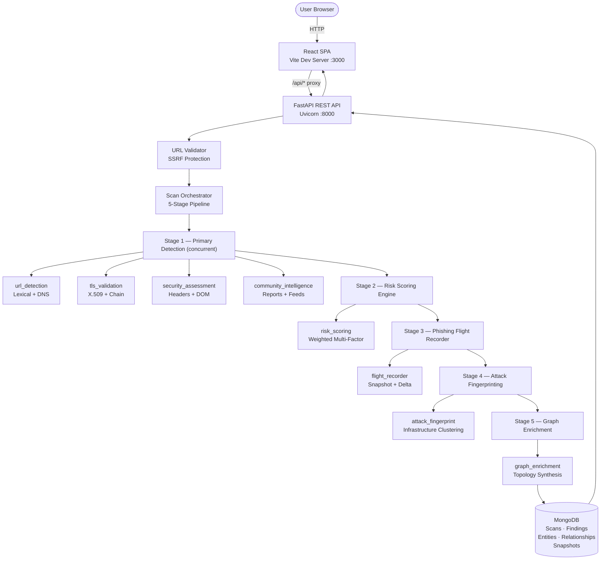
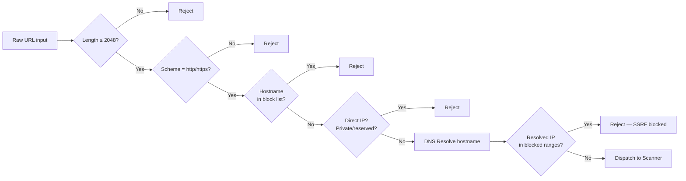
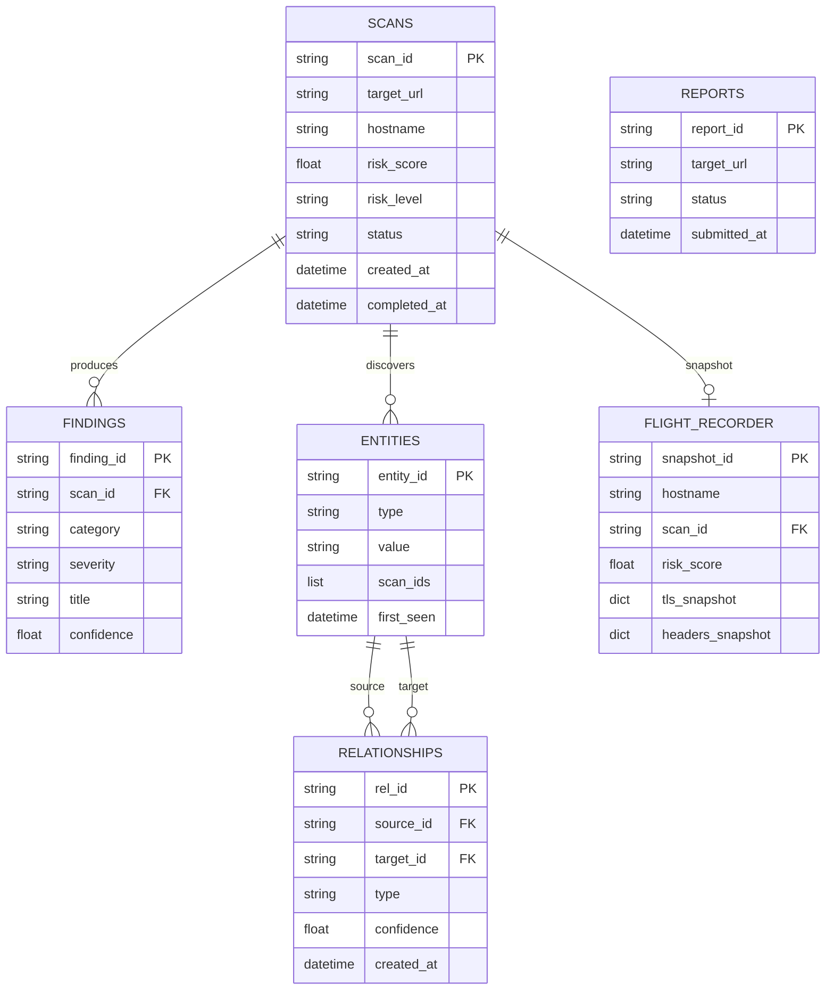

# PHANTOM

**Phishing Detection & Digital Threat Investigation Platform** — a full-stack cybersecurity tool that moves beyond basic URL checkers to deliver multi-layer forensic analysis, infrastructure correlation, and interactive investigation graphs.


---

## Table of Contents

1. [Problem](#1-problem)
2. [Solution](#2-solution)
3. [Demo Links & Screenshot](#3-demo-links--screenshot)
4. [Tech Stack](#4-tech-stack)
5. [Architecture](#5-architecture)
6. [Setup & Run Steps](#6-setup--run-steps)
7. [Disclosures](#7-disclosures)
8. [Track](#8-track)

---

## 1. Problem

Phishing is among the most prevalent and damaging attack vectors in modern cybersecurity. Attackers have evolved far beyond crude misspelled URLs: today's phishing infrastructure routinely uses valid HTTPS certificates, trusted CDN providers, and subtly manipulated Unicode to impersonate banks, cloud services, and government portals in ways that defeat the judgment of ordinary users.

**The specific problems PHANTOM addresses:**

| Problem | Why it matters |
|---|---|
| **Typosquatting & lookalike domains** | Attackers register domains one character away from legitimate brands (e.g. `paypa1.com`, `micosoft.com`) specifically to harvest credentials. |
| **Punycode & homograph attacks** | Internationalized domain names can render identically to real domains in browsers (`аpple.com` using Cyrillic 'а'). |
| **Abuse of valid TLS certificates** | A padlock no longer means a site is safe — phishing kits obtain free, valid certificates from automated CAs. Certificate validity and website legitimacy are orthogonal properties. |
| **DNS-level threat indicators** | Shared nameservers, recently registered domains, and disposable IP hosting are strong phishing signals invisible to users. |
| **Missing historical visibility** | A snapshot of a domain's risk posture today tells you nothing about whether its certificate changed last week, or whether its security headers disappeared. |
| **Fragmented threat intelligence** | Community reports, external IP reputation, open port data, and internal scan findings live in separate tools with no unified investigation workflow. |
| **Campaign-level blind spots** | Individual URL checkers cannot identify whether a suspicious site shares infrastructure with a dozen previously-seen phishing domains. |

Existing free URL-checkers perform a single-point, low-depth lookup and return a binary safe/unsafe verdict. They lack multi-factor reasoning, historical comparison, infrastructure correlation, and investigation graph capabilities that professional analysts need.

---

## 2. Solution

PHANTOM is an analyst-grade investigation platform that brings eight interconnected capabilities to bear on a single URL submission.

### Eight Core Capabilities

#### 1 — URL Detection & Lexical Threat Analysis
Performs deep lexical analysis of the submitted URL and its hostname:
- **Shannon entropy** scoring for randomly generated domain names.
- **Phishing keyword detection** in paths and subdomains (`login`, `verify`, `secure`, `wallet`, etc.).
- **Suspicious TLD classification** against a curated list of frequently-abused registries (`.xyz`, `.top`, `.tk`, `.buzz`, etc.).
- **Punycode and homograph detection** — decoded internationalized domains are compared against known brand patterns.
- **Typosquatting detection** — Levenshtein edit distance ≤ 3 against a list of 23 high-value target brands.
- **DNS resolution** of A/AAAA records, nameservers, and MX records as infrastructure indicators.

#### 2 — TLS Certificate Intelligence
Two-stage verified TLS connection with forensic fallback:
- Full X.509 certificate parsing (subject, issuer, serial, validity window, SANs, public key algorithm and size).
- **Chain verification** against Python's system CA store with proper SNI hostname matching.
- Self-signed certificate detection, untrusted root detection, and expiry detection with days-remaining countdown.
- Wildcard certificate validation with strict single-label matching.
- Preservation of the exact SSL verification error (expiration, hostname mismatch, untrusted CA, etc.).
- Plain HTTP sites are marked **TLS: Not Applicable** rather than treated as malicious.
- Network timeouts and connection failures are classified separately from certificate security failures.

#### 3 — Website Security Assessment
Automated HTTP-level security posture review:
- **Security header audit**: HSTS, Content Security Policy, X-Frame-Options, X-Content-Type-Options.
- **DOM form heuristics**: detects credential harvesting forms including password fields and cross-origin `action` attributes.
- **Redirect chain analysis**: records all redirect hops and flags cross-domain redirections.

#### 4 — Explainable Risk Scoring
A multi-factor, weighted scoring engine (0–100 scale):
- Risk score computed from severity-weighted, confidence-adjusted finding aggregation.
- Risk levels: **None / Low / Medium / High / Critical**.
- Per-factor breakdown visible in the UI with individual contribution weights.
- Fully explainable: every point deducted is traceable to a specific finding.

#### 5 — Community Threat Intelligence
Crowd-sourced threat reporting with analyst moderation:
- Submission deduplication by reporter identifier and content hash.
- Review states: `pending` → `verified` / `corroborated` / `under_review` / `disputed` / `rejected`.
- Rejected reports are safely dismissed and produce zero threat findings.
- **Optional external intelligence feeds** (require API keys — degrade gracefully without them):
  - **VirusTotal** domain reputation.
  - **AbuseIPDB** IP reputation and abuse confidence score.
  - **Shodan** open port and service enumeration.

#### 6 — Flight Recorder & Historical Drift Detection
Point-in-time security snapshot capture and longitudinal comparison:
- Immutable snapshots record: hostname, risk score, confidence, TLS certificate fingerprint and issuer, security headers, redirect hops, and the full findings summary.
- **Delta analysis** between consecutive scans detects: new findings, resolved findings, TLS certificate replacement (fingerprint, issuer, or self-signed status drift), security header removal, and risk score escalations (>15-point increase emits a behavioral finding).
- First-ever scan for a domain explicitly records `has_history: false` and fabricates no historical data.

#### 7 — Attack Fingerprinting & Infrastructure Correlation
Evidence-based identification of potentially related malicious domains:
- Correlates the target against all historical domain entities in MongoDB using four independent indicators:
  - Shared resolved IP addresses.
  - Identical TLS certificate SHA-256 fingerprints.
  - Impersonation of the same target brand keyword.
  - Levenshtein edit distance ≤ 3 (high lexical similarity).
- Uses defensible, evidence-backed language: "Shared observable infrastructure" and "Potentially related domains." No speculative attributions.
- Generates structured relationship edges when multi-factor indicators align.

#### 8 — Investigation Graph & Graph Enrichment
Visual investigation workspace with an interactive entity-relationship graph:
- Normalizes all discovered entities (URL, Domain, IP address, TLS certificate, Community Report, Nameserver) into deterministic IDs (e.g. `domain:example.com`, `ip:1.2.3.4`).
- Deduplicates relationship edges across all modules; each edge carries timestamps, confidence scores, and explanatory metadata.
- Queryable via REST API with filtering by entity type, relationship type, date range, scan ID, and hostname.
- Rendered in the browser as an interactive SVG canvas with force-directed layout, pan/zoom, node dragging, and an evidence inspection drawer.

### Five-Stage Scanning Pipeline

```
URL Submission & DNS SSRF Validation
  │
  ▼
Stage 1 — Primary Detection (concurrent)
  URL Detection · TLS Certificate Intelligence
  Security Assessment · Community Intelligence
  │
  ▼
Stage 2 — Explainable Risk Scoring Engine
  │
  ▼
Stage 3 — Phishing Flight Recorder
  Snapshot capture · Historical drift delta
  │
  ▼
Stage 4 — Attack Family Fingerprinting
  Shared infrastructure clustering
  │
  ▼
Stage 5 — Graph Enrichment
  Topology synthesis · Edge deduplication
  │
  ▼
Database Persistence
  Scans · Findings · Entities · Relationships · Snapshots
```

**Important disclaimer:** PHANTOM produces structured threat indicators that require analyst verification. Findings are evidence-backed signals, not definitive proof of malicious intent. PHANTOM is intended for authorized security research, defensive analysis, and educational use only.

---

## 3. Demo Links & Screenshot

| Resource | Link |
|---|---|
| **GitHub Repository** | <!-- TODO: Add your public GitHub repository URL here --> `[Add GitHub Repository URL]` |
| **Live Application** | <!-- TODO: Deploy and add live URL --> `[Add Live Demo URL]` |
| **Demo Video** | <!-- TODO: Record a ≤3-minute walkthrough and upload --> `[Add Demo Video URL — max 3 minutes]` |
| **Swagger API Docs** | `http://127.0.0.1:8000/docs` *(local development)* |
| **Health Check** | `http://127.0.0.1:8000/health` *(local development)* |

### Application Screenshot

<!-- TODO: Add dashboard screenshot -->
> **No screenshots are present in the repository at this time.**
> To add one: take a screenshot of the running application, save it to `docs/screenshot.png`, and replace this block with:
> ```markdown
> 
> ```

---

## 4. Tech Stack

### Backend

| Technology | Version | Role |
|---|---|---|
| **Python** | 3.11+ | Primary backend language |
| **FastAPI** | 0.115.6 | Async REST API framework |
| **Pydantic** | 2.10.4 | Data validation and schema models |
| **Pydantic-Settings** | 2.7.1 | Environment configuration management |
| **Motor** | 3.7.0 | Async MongoDB driver |
| **PyMongo** | 4.10.1 | Synchronous MongoDB client (Motor dependency) |
| **HTTPX** | 0.28.1 | Async HTTP client for external intelligence requests |
| **Cryptography** | 44.0.0 | X.509 certificate parsing and TLS analysis |
| **DNSPython** | 2.7.0 | DNS A/AAAA/NS/MX record resolution |
| **NetworkX** | 3.4.2 | Graph topology data structures |
| **SlowAPI** | 0.1.9 | Rate limiting middleware |
| **Python-WHOIS** | 0.9.4 | Domain registration data retrieval |
| **Validators** | 0.34.0 | URL and hostname format validation |
| **BeautifulSoup4** | 4.12.3 | DOM parsing for form heuristics |
| **lxml** | 5.3.0 | High-performance HTML/XML parser (BS4 backend) |
| **Uvicorn** | 0.34.0 | ASGI server |
| **python-dotenv** | 1.0.1 | `.env` file loading |

### Frontend

| Technology | Version | Role |
|---|---|---|
| **React** | 18.3.1 | UI component library |
| **React-DOM** | 18.3.1 | React DOM renderer |
| **Vite** | 6.0.7 | Build tool and dev server |
| **@vitejs/plugin-react** | 4.3.4 | Vite plugin for React Fast Refresh |
| **JavaScript (ES Modules)** | — | Frontend language |
| **CSS** | — | Styling and design system |
| **SVG Canvas** | — | Interactive investigation graph (no external graph library) |

> **Note:** The investigation graph is built using a custom SVG-based force layout renderer — no external charting library is used.

### Testing

| Tool | Role |
|---|---|
| **Pytest** | Test runner |
| **pytest-asyncio** | Async test execution |
| **unittest.mock** | Module isolation / patching |
| **HTTPX** | HTTP transport mock in integration tests |

### External Intelligence Integrations (Optional)

| Service | Purpose | Required? |
|---|---|---|
| **VirusTotal** | Domain reputation lookup | No — degrades gracefully |
| **AbuseIPDB** | IP abuse confidence scoring | No — degrades gracefully |
| **Shodan** | Open port and service enumeration | No — degrades gracefully |

### Infrastructure

| Component | Details |
|---|---|
| **MongoDB** | 6.0+ — primary data store for scans, findings, entities, relationships, and snapshots |

---

## 5. Architecture

### High-Level Architecture



### Backend Architecture

The backend is a fully async FastAPI application structured into four layers:

**1. Security Layer** (`app/security/url_validator.py`)
- Validates URL scheme (only `http`/`https` allowed).
- Blocks RFC 1918 private IPs, loopback addresses (`127.x.x.x`), link-local (`169.254.x.x`), cloud metadata endpoints, and all IPv6 reserved ranges at the URL-parse level.
- Performs DNS resolution of the submitted hostname and validates the resolved IP against the same blocklist (SSRF protection).
- Enforces a 2,048-character URL length limit.

**2. API Layer** (`app/routers/`)
Six FastAPI routers registered under `/api`:

| Router | Endpoints |
|---|---|
| `health.py` | `GET /health` |
| `scans.py` | `POST /api/scans`, `GET /api/scans/{id}`, `GET /api/scans/{id}/findings` |
| `domains.py` | `GET /api/domains/{hostname}/history`, `GET /api/domains/{hostname}/compare` |
| `reports.py` | `POST /api/reports`, `GET /api/reports`, `PATCH /api/reports/{id}` |
| `entities.py` | `GET /api/entities/{id}/relationships` |
| `graph.py` | `GET /api/graph` *(with entity type, relationship type, date range, scan ID, hostname filters)* |

**3. Scanner Layer** (`app/scanner/`)
- `orchestrator.py`: The `ScanOrchestrator` class manages module registration, dispatches Stage 1 modules concurrently using `asyncio.gather`, and executes Stages 2–5 sequentially. Each module call is wrapped in `asyncio.wait_for` with a 30-second per-module timeout.
- Nine registered modules: `placeholder`, `url_detection`, `tls_validation`, `security_assessment`, `risk_scoring`, `community_intelligence`, `flight_recorder`, `attack_fingerprint`, `graph_enrichment`.

**4. Persistence Layer** (`app/database.py`)
- Async Motor connection lifecycle with startup index creation.
- Collections: `scans`, `findings`, `entities`, `relationships`, `reports`, `flight_recorder`.
- Entities are upserted by `(type, value)` with `scan_ids` accumulation across multiple scans.

### Frontend Architecture

The React SPA (`frontend/src/`) is a single `App.jsx` state coordinator that renders one of eight page components based on `activePage` state. The Vite dev server proxies all `/api` and `/health` requests to the FastAPI backend, eliminating CORS issues in development.

**Eight Views:**

| View | Component | Purpose |
|---|---|---|
| Dashboard | `Dashboard.jsx` | Platform statistics, threat breakdown, and recent scan feed |
| Scanner | `ScannerHome.jsx` | URL submission form with per-module toggle switches |
| Scan Report | `ScanReport.jsx` | Risk score gauge (0–100), confidence, factor breakdown, filtered findings |
| Certificate Details | `CertificateDetails.jsx` | X.509 fields, chain status, SANs, issuer, validity window |
| Security Assessment | `SecurityAssessment.jsx` | HSTS/CSP/XFO/XCTO header matrix, DOM form analysis, redirect hops |
| Flight Recorder | `FlightRecorder.jsx` | Historical scan timeline and drift delta comparison |
| Community Reports | `CommunityReports.jsx` | Crowd report feed, submission modal, analyst moderation |
| Investigation Graph | `InvestigationGraph.jsx` | Interactive SVG canvas: force layout, pan/zoom, node drag, evidence drawer |

### Security Architecture



Blocked ranges include: `0.0.0.0/8`, `10.0.0.0/8`, `127.0.0.0/8`, `169.254.0.0/16`, `172.16.0.0/12`, `192.168.0.0/16`, `224.0.0.0/4` (multicast), and all IPv6 reserved ranges.

### Data Architecture



---

## 6. Setup & Run Steps

### Prerequisites

| Requirement | Minimum Version | Notes |
|---|---|---|
| **Python** | 3.11 | 3.13 verified in CI |
| **Node.js** | 18 LTS | Includes npm |
| **MongoDB** | 6.0 | Local or Docker |
| **Git** | Any | For cloning |

---

### Step 1 — Clone the Repository

```powershell
git clone [Add GitHub Repository URL]
cd phantom
```

---

### Step 2 — Backend Setup

```powershell
cd backend
python -m venv venv
.\venv\Scripts\Activate.ps1
pip install -r requirements.txt
```

Configure environment variables:

```powershell
Copy-Item .env.example .env
```

Open `.env` and review the following settings:

| Variable | Default | Action required |
|---|---|---|
| `MONGODB_URI` | `mongodb://localhost:27017` | Update if MongoDB is remote |
| `MONGODB_DB_NAME` | `phantom` | Leave as-is for local dev |
| `VIRUSTOTAL_API_KEY` | *(empty)* | Optional — add key to enable |
| `ABUSEIPDB_API_KEY` | *(empty)* | Optional — add key to enable |
| `SHODAN_API_KEY` | *(empty)* | Optional — add key to enable |

> The external API keys are entirely optional. All three external intelligence integrations fail gracefully with `not_configured` or `unavailable` status when keys are absent.

---

### Step 3 — Start MongoDB

**Option A — Local mongod:**
```powershell
mongod --dbpath C:\data\db
```

**Option B — Docker:**
```powershell
docker run -d -p 27017:27017 --name phantom-mongo mongo:7
```

Verify MongoDB is reachable at `mongodb://localhost:27017` before starting the backend.

---

### Step 4 — Start the FastAPI Backend

From the `backend/` directory (with venv activated):

```powershell
uvicorn app.main:app --host 127.0.0.1 --port 8000 --reload
```

Verify the backend is running:

| Endpoint | URL |
|---|---|
| **Health check** | http://127.0.0.1:8000/health |
| **Swagger UI** | http://127.0.0.1:8000/docs |
| **ReDoc** | http://127.0.0.1:8000/redoc |

---

### Step 5 — Frontend Setup

Open a **second** PowerShell terminal:

```powershell
cd frontend
npm install
npm run dev
```

The Vite development server starts on port **3000** and automatically proxies all `/api` and `/health` requests to the FastAPI backend at `127.0.0.1:8000`. No manual CORS configuration is required.

---

### Step 6 — Access the Application

| Resource | URL |
|---|---|
| **Frontend** | http://localhost:3000 |
| **API (Swagger)** | http://127.0.0.1:8000/docs |
| **Health** | http://127.0.0.1:8000/health |

---

### Step 7 — Run the Test Suite

From the **repository root** with the backend venv activated:

```powershell
cd backend
.\venv\Scripts\Activate.ps1
cd ..
python -m pytest backend/tests -v
```

**Expected output:**

```
platform win32 -- Python 3.13.x, pytest-9.x.x
...
63 tests collected

backend/tests/test_attack_fingerprint.py    ...
backend/tests/test_community_intelligence.py......
backend/tests/test_flight_recorder.py       ....
backend/tests/test_graph_enrichment.py      ...
backend/tests/test_integration_pipeline.py  ..
backend/tests/test_models.py                ....
backend/tests/test_orchestrator.py          ....
backend/tests/test_risk_scoring.py          ....
backend/tests/test_security_assessment.py   .....
backend/tests/test_tls_validation.py        .............
backend/tests/test_url_detection.py         .......
backend/tests/test_url_validator.py         .....

========================= 63 passed =========================
```

> **Note on asyncio (Windows):** The test suite uses `pytest-asyncio` with `asyncio_mode = "auto"`. If you encounter `SelectorEventLoop` warnings on Windows, they are non-fatal and do not affect test outcomes.

---

### Step 8 — Production Frontend Build

```powershell
npm run build --prefix frontend
```

Production-optimized static assets are generated to `frontend/dist/`. Serve this directory with any static file server or web server (nginx, Caddy, etc.) and point your API calls to the deployed FastAPI backend.

---

## 7. Disclosures

### Open-Source Libraries & Frameworks

| Library | License | Purpose |
|---|---|---|
| FastAPI | MIT | Backend API framework |
| Pydantic | MIT | Data validation |
| Motor | Apache 2.0 | Async MongoDB driver |
| HTTPX | BSD-3 | Async HTTP client |
| Cryptography | Apache 2.0 / BSD | X.509 and TLS parsing |
| DNSPython | ISC | DNS resolution |
| NetworkX | BSD-3 | Graph data structures |
| SlowAPI | MIT | Rate limiting |
| BeautifulSoup4 | MIT | HTML/DOM parsing |
| lxml | BSD-3 | HTML parser backend |
| Validators | MIT | URL/hostname validation |
| Python-WHOIS | MIT | Domain WHOIS data |
| React 18 | MIT | Frontend UI framework |
| Vite | MIT | Frontend build tool |

### External Intelligence Services

| Service | Integration type | Required? |
|---|---|---|
| **VirusTotal** | REST API (domain lookup) | Optional — API key needed |
| **AbuseIPDB** | REST API (IP reputation) | Optional — API key needed |
| **Shodan** | REST API (open ports) | Optional — API key needed |

All three integrations are non-blocking: the scan pipeline completes normally if API keys are absent or if the external service is unavailable.

### Templates & UI Libraries

No external UI component libraries, CSS frameworks, icon packs, or design templates were used. The frontend design system (custom dark theme, typography, layout) is entirely hand-authored in `frontend/src/index.css`. The investigation graph renderer is a custom SVG-canvas implementation — no third-party graph visualization library is included.

### No Secrets Exposed

The repository does not contain any API keys, passwords, database credentials, or other secrets. The `.env` file is excluded by `.gitignore`. The `.env.example` file contains only safe placeholder values.

### AI Coding Assistants

<!-- TODO: Confirm and list the AI coding assistants (e.g., GitHub Copilot, ChatGPT, Claude, Gemini) used during development and add them here. Example:
- **[AI Tool Name]**: Used for [describe purpose — e.g., code review, documentation, boilerplate generation].
-->
> *[TODO: The project team should confirm and disclose all AI coding assistants used during development of this project.]*

---

## 8. Track

> **[TODO: Insert official HackMatrix '26 track name]**

<!-- TODO: Replace the placeholder above with the exact official track name from the HackMatrix participant handbook, e.g.:
- "Cybersecurity & Threat Intelligence"
- "Open Innovation"
- etc.
-->

**How PHANTOM aligns with a cybersecurity track:**

PHANTOM directly addresses active cybersecurity threats — phishing, domain impersonation, infrastructure reuse across attack campaigns, and the absence of longitudinal visibility into suspicious domains. The platform demonstrates:

- A complete, deployable security tool built from scratch during the hackathon.
- Novel integration of URL lexical analysis, TLS intelligence, community reporting, historical drift detection, and attack infrastructure correlation into a single unified workflow.
- An investigation-first design philosophy: rather than returning a single binary verdict, PHANTOM produces structured, evidence-backed findings that empower analysts to investigate, compare, and correlate threats over time.

---

## Project Documentation

| Document | Description |
|---|---|
| [PHANTOM_API_CONTRACT.md](PHANTOM_API_CONTRACT.md) | Complete REST API endpoint contracts and request/response schemas |
| [PHANTOM_DATABASE_SCHEMA.md](PHANTOM_DATABASE_SCHEMA.md) | MongoDB collection schemas, indexes, and model documentation |
| [PHANTOM_BACKEND_SETUP.md](PHANTOM_BACKEND_SETUP.md) | Backend onboarding guide and module extension instructions |
| [PHANTOM_WORK_DONE.md](PHANTOM_WORK_DONE.md) | Engineering progress report and architecture decisions |
| [PHANTOM_COMPUTER3_HANDOVER.md](PHANTOM_COMPUTER3_HANDOVER.md) | Integration handover report (Phase 6–8) |

---

*PHANTOM is designed for authorized security research, defensive threat analysis, and educational purposes. All scan results are analytical indicators that require expert verification. Never use this tool against systems you do not have explicit permission to investigate.*

